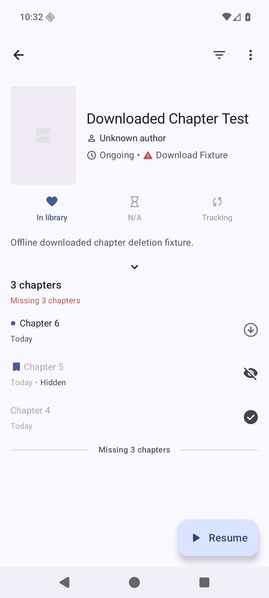
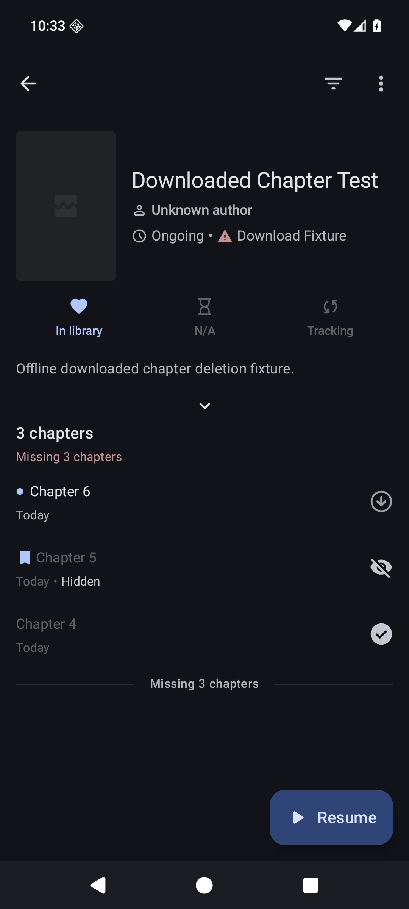
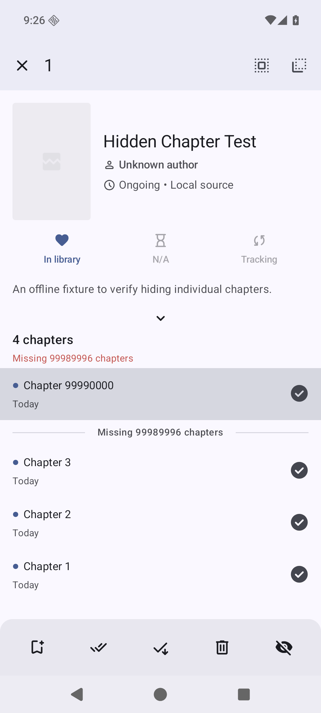
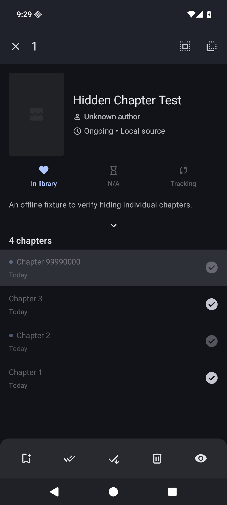
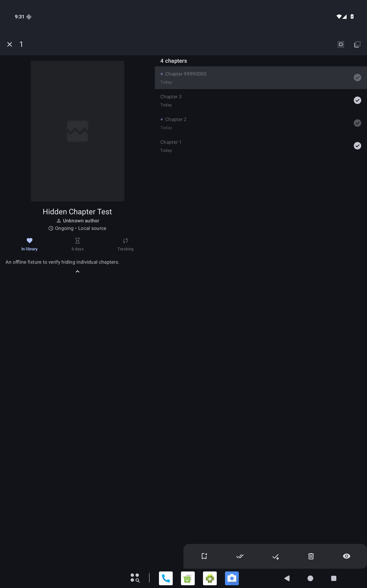

# Hide and unhide individual chapters

Related request: https://github.com/mihonapp/mihon/issues/1916

Selecting chapters adds a Hide action to the chapter selection bar. When every
selected chapter is hidden, the action becomes Unhide. Mixed selections hide all
selected chapters.

Hidden chapters stay in their normal list position with a small Hidden label
beside the date and a crossed-eye icon replacing the download indicator on the
right. Title and metadata dimming applies once, even for chapters that are both
read and hidden. The label and icon remain at normal contrast so hidden chapters
can be distinguished from read chapters. Long press still
selects them, and taps toggle selection while selection mode is active. They
cannot open the reader or start downloads. Hiding preserves reading progress and
bookmarks. Hiding cancels queued downloads and removes eligible completed and
partial downloaded files using the existing deletion settings. Bookmarked copies
remain when Allow deleting bookmarked chapters is off, and excluded categories
protect read chapters as they do for normal deletion. Unread chapters in excluded
categories remain eligible. Protected copies, unrelated downloads and local-source
original files are retained. All hidden chapters remain unavailable for reading
and new downloads, including those with protected copies. Unhiding allows downloading again, but does not
restore deleted files or automatically download them.

Deletion eligibility uses current database flags rather than the selection's
snapshot. Uncategorized entries use the Default category for exclusions. Hiding
a mixed selection cancels all selected downloads, then deletes only eligible
copies; protected chapters still contribute their filename ownership claims.

The reader skips hidden chapters regardless of the Skip filtered chapters
setting. Hiding chapter 5 makes chapters 4 and 6 adjacent in both directions.
The first and last non-hidden chapters become the reader’s first and last
chapters. Resume and download ahead skip hidden chapters too, including when the history
anchor was subsequently hidden. Hidden chapters do not extend the range used
for missing-chapter warnings, and known hidden chapters within that range do
not become missing chapters. This handles an unwanted Chapter 99990000 above
Chapter 203 without removing the unwanted row from the list.

## Persistence

Database migration 20 adds `chapter.user_hidden`, defaulting existing chapters
to visible, and updates the library and updates views. Source metadata refreshes
preserve the flag. Replacement chapter URLs inherit it by recognized chapter
number, following existing progress and bookmark transfer behavior.

Backups use optional protobuf field 14. Older backups default to visible;
restoring into an existing library preserves a hidden flag from either copy.

## Validation

Regression coverage includes hidden outliers, known hidden chapter gaps, both
sort directions, all-hidden lists, selecting hidden rows, resume anchors and
protobuf compatibility. Download queue coverage checks current chapter state
when restoring a saved queue. Hide cleanup coverage includes cancellation of
active writers, completed and partial files, bookmark/category protections,
sibling filename collisions, manga sharing a download directory, and inaccessible storage. Ownership is resolved from
the current chapter records; ambiguous legacy paths shared with other chapters
are retained to protect their files. This includes manga with titles that map
to the same directory. Storage failures leave the chapter hidden
and show an error; the snackbar’s Retry action retries cleanup without unhiding.

Run the repository checks with the configured JDK and Android SDK:

```sh
./gradlew spotlessCheck testDebugUnitTest verifySqlDelightMigration :app:assembleDebug --max-workers=2
```

Native review flow:

1. Open an entry with normal chapters and an unwanted high-numbered chapter.
2. Long press the unwanted chapter and tap the fifth action, Hide.
3. Confirm the dimmed row remains with a Hidden label and crossed-eye icon instead
   of a download indicator, and its tap/download/swipe actions cannot
   open or download it. Confirm the missing-chapter warning ignores it.
4. Long press the dimmed row and tap Unhide. Confirm normal interaction returns.
5. Hide multiple chapters, then test a mixed selection and an all-hidden selection.
6. Verify Start/Resume and reader next/previous navigation skip hidden chapters,
   with Skip filtered chapters both enabled and disabled.
7. Repeat after refreshing, restarting and restoring a backup. Verify queued
   hidden chapters do not resume downloading and eligible downloaded files are gone;
   protected copies and unrelated completed downloads must remain. Verify the
   bookmark deletion option and read/unread chapters in excluded categories. Unhide and confirm files are not
   restored or downloaded automatically.
8. Check phone and tablet layouts, light and dark themes, and accessibility
   announcements for hidden rows.

Verified locally on 25 October 2026 using JDK 21 and Android SDK 37.2:

- 103 domain tests and 119 app tests passed, with no skips or failures.
- SQLDelight debug/release migration verification and repository formatting checks passed.
- Debug APK assembled successfully. The accepted deletion-policy update reran all
  119 app tests, formatting and APK assembly; the domain/data implementation is unchanged.
- Android 16 ARM64 emulator: phone and tablet layouts, light/dark mode,
  Hide/Unhide, disabled row taps, mixed/all-hidden selections, refresh, restart,
  and reader chapter 1 → 3 navigation with hidden chapter 2 passed.
- Reader skipping was checked with Skip filtered chapters enabled and disabled.
- Independent source review findings about existing download queues and reader
  gap warnings, cleanup ownership, cleanup Retry and deletion-policy integration were repaired and
  re-reviewed with no further source findings. Cross-provider review was unavailable.

Native verification used an offline local-source fixture and synthetic
downloaded copies under a stub source. Hide retained the protected chapter 5
folder, archive and partial files. A mixed selection removed unread chapter 6
while retaining protected chapter 5. Enabling bookmark deletion and clearing the
category exclusion through Settings made chapter 5 eligible; hiding it then
removed its folder, archive and partial files. Chapter 4, local originals,
reading progress and bookmarks remained intact. Unhide does not restore deleted files. A chapter named with a
sibling’s `_tmp` suffix retained its files. A second manga with the same title
retained its shared download paths. Making the download root unreadable showed
the failure snackbar with Retry; restoring access and tapping Retry removed the
target files without unhiding or changing progress/bookmarks.

Native verification used no extension network requests. Physical devices,
remote extension network behavior and a full manual backup import were not
exercised; protobuf compatibility is covered by automated tests.

## Native screenshots

Current hidden-row appearance: chapter 5 has a Hidden label and crossed-eye icon, chapter 4 is
read, and chapter 6 is unread. Verified in both themes; tapping the hidden status
icon does not open the reader, long pressing it selects the row, and Unhide/Hide
still work. The label remains when the chapter is unread. The component’s nullable-date
branch was checked in source; the current manga screen formats a zero timestamp
as an epoch date, so that fixture does not exercise a null date. Hidden/read title opacity is applied once, and the existing row state
description announces Hidden while the visible label avoids a duplicate
accessibility announcement. APK assembly, formatting and all 119 app tests passed
for this label update. TalkBack runtime was not exercised.





Earlier selection-layout captures below predate the crossed-eye row indicator.

The offline local-source fixture uses Delete in the fourth slot because its
chapters are already available locally; Hide/Unhide is the fifth action.






